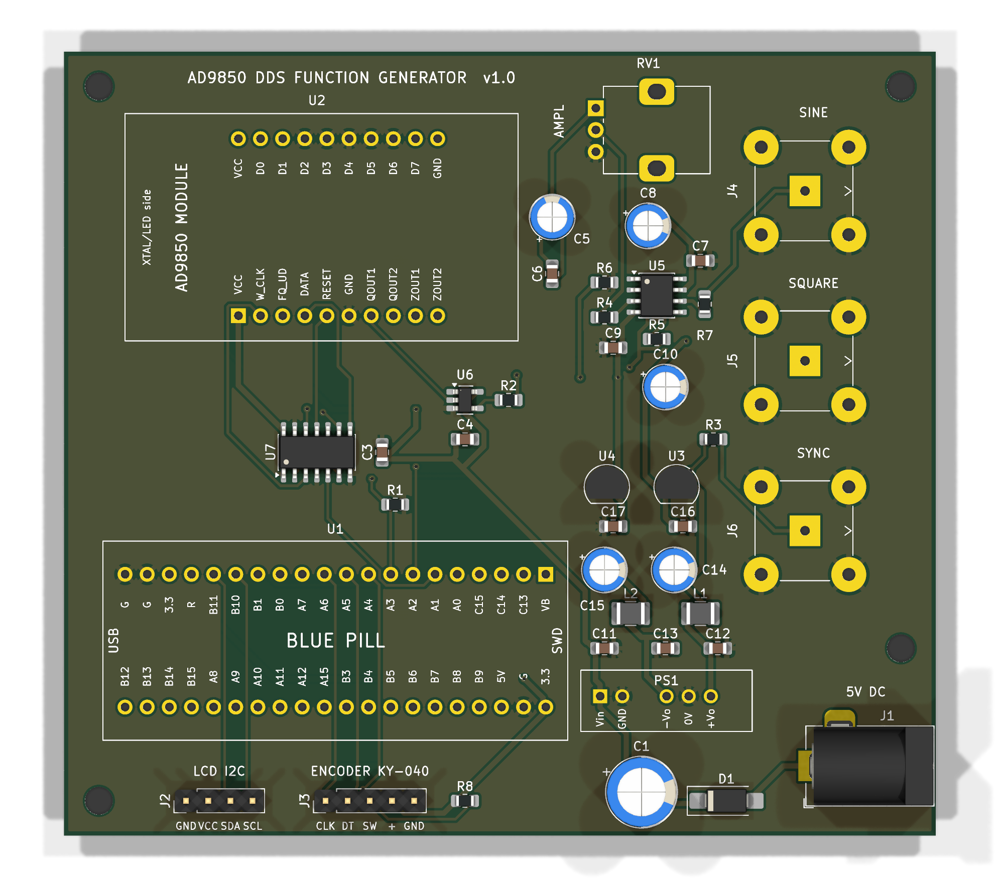

# Carrier PCB (KiCad 10)

100 × 90 mm, 2-layer board that carries the Blue Pill and the AD9850 module on
female headers, plus the output stage.



## What is on the board
- **Blue Pill** socket (2 × 1×20 female headers, rows 15.24 mm apart, USB towards the left edge).
- **AD9850 module (HC-SR08)** socket (2 × 1×10 female headers).
- **74AHCT125** level shifter: PA0/PA1/PA2/PA3 → W_CLK/FQ_UD/DATA/RESET. The STM32's 3.3 V
  logic is below the AD9850's 3.5 V input-high minimum at 5 V supply, so the buffer makes it reliable.
  RESET is driven by PA3; R1 keeps it low (the current firmware leaves PA3 as an input).
- Data row of the module: D2…D6 tied to GND (guarantees serial mode). VCC, D7 and GND
  of that row are deliberately **not connected**, because some modules have D7 and GND swapped.
- **Sine output (J4, BNC)**: ZOUT2 → 22 µF + 100 nF AC coupling (centres the sine on 0 V) →
  1 k amplitude pot RV1 → LM7171, gain 4 → 49.9 Ω → BNC.
- **Square output (J5, BNC)**: QOUT1 → 74LVC1G17 buffer → 68 Ω → BNC (0–5 V into high-Z).
- **Sync output (J6, BNC)**: PB0 → 100 Ω (needs the sync firmware feature).
- **Power**: 5 V DC jack (2.1 mm, centre +) → SS34 reverse protection → +5V.
  A0515S-2WR3 isolated DC-DC → LC filter → 78L12 / 79L12 → ±12 V for the LM7171.
- Headers: **J2** LCD (GND, VCC, SDA, SCL), **J3** KY-040 (CLK, DT, SW, +, GND), R8 = 10 k SW pull-up.
- 4 × M3 mounting holes.

## Check before ordering
1. **AD9850 module row spacing**: set to 20.32 mm (`AD9850_ROW_SPACING` in `tools/design.py`).
   The seller drawing says "20 mm" – measure your module.
2. **Blue Pill orientation**: with USB on the left, the top row must read
   `G G 3.3 R B11 B10 … A0 C15 C14 C13 VB`. The silkscreen shows every pin name – compare with your board.
3. Power the board from the DC jack **or** the Blue Pill USB, not from both at the same time.

## Files
| Path | Content |
|---|---|
| `DDS_FuncGen/DDS_FuncGen.kicad_pro` | KiCad project (open this) |
| `DDS_FuncGen/production/DDS_FuncGen_gerbers_JLCPCB.zip` | Gerbers + drill, ready to upload |
| `DDS_FuncGen/production/DDS_FuncGen_BOM.csv` | Bill of materials |
| `DDS_FuncGen/production/DDS_FuncGen_schematic.pdf` | Schematic |
| `DDS_FuncGen/production/erc.rpt`, `drc.rpt` | 0 ERC errors, 0 DRC violations, 0 unconnected |
| `tools/design.py` | Parts, nets and positions (single source) |
| `tools/gen_project.py` | Generates libraries, schematic and PCB from `design.py` |
| `tools/route.py` | Autoroutes with Freerouting and adds GND planes |

## Regenerating
```
"%LOCALAPPDATA%\Programs\KiCad\10.0\bin\python.exe" tools\gen_project.py
"%LOCALAPPDATA%\Programs\KiCad\10.0\bin\python.exe" tools\route.py <freerouting-2.1.0.jar> <java.exe>
```
`gen_project.py --sch-only` rewrites only the schematic and libraries, leaving the routed PCB alone.
Freerouting 2.1.0 runs on Java 21 (the JRE bundled with STM32CubeIDE works).
